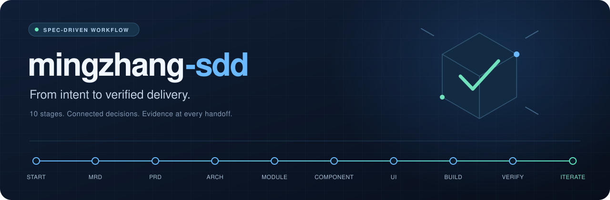

<p align="center">
  <a href="README.md"></a>
  <a href="README.en.md"></a>
</p>

<p align="center">
  
</p>

<h1 align="center">mingzhang-sdd</h1>

<p align="center"><strong>把想法说清楚，把规格接起来，把结果验明白。</strong></p>
<p align="center">面向 AI 编程协作的 SDD 技能 · 从需求澄清到开发、联调与迭代</p>

<p align="center">
  
  
  
</p>

<p align="center">
  <a href="#quick-start">快速开始</a> ·
  <a href="#zcode-plugin">ZCode 插件安装</a> ·
  <a href="#dsh-plugin">DSH 插件安装</a> ·
  <a href="#workflow">十阶段流程</a> ·
  <a href="#inside">资源导航</a> ·
  <a href="#validation">版本与验证</a>
</p>

---

当你把产品开发交给 AI，真正需要接续的是：**为什么做、具体做什么、怎样实现，以及如何确认做对了。**

mingzhang-sdd 将这些工作组织为可按需读取的阶段方法，帮助 Agent 围绕当前目标协作：澄清需求、承接已有决定、形成成果、检查结果，再由用户确认关键取舍。新项目可以从准备开始，已有项目可以从当前节点接续。

## 它能帮你做什么

| 你正在处理的事 | 技能提供的协作方式 |
| :--- | :--- |
| **想法还没讲清楚** | 澄清问题、目标、价值与范围；确认的需求及时暂存，再形成 MRD／PRD。 |
| **规格需要落到设计** | 连接架构、模块、组件与交互，说明职责、接口、异常和验收关系。 |
| **已有项目继续推进** | 先核对有效成果、当前状态与本次允许范围，选择对应阶段方法。 |
| **按开发包组织实施** | 划分开发包、依赖路线及可并行条件；宿主不支持并行时按路线串行交错，不冒充并行。 |
| **资料与版本需要接续** | 明确文件职责、信息权威、历史取代、跨阶段基线及源码与制品身份。 |
| **实现需要检查和验收** | 按获准功能开发，记录实际验证；将程序结果、用户验收和发布决定分别说明。 |
| **反馈需要变成下一步** | 分析来源与影响，提出取舍建议，按确认后的范围回到相应阶段。 |

每个阶段都回答三个问题：**是什么 · 做什么 · 怎么做**。按当前任务选择方法，关键决定由用户确认。

<a id="quick-start"></a>
## 快速开始

### 1. 获取技能

```bash
git clone https://github.com/liuchao1314lc-debug/mingzhang-sdd.git
```

也可以通过仓库的 **Code → Download ZIP** 下载。保留完整目录结构，入口是 [SKILL.md](SKILL.md)。

### 2. 在目标项目中使用

将下面的路径换成真实**绝对路径**，发送给能读取本地文件的 Agent：

```text
请读取并使用 <技能仓库绝对路径>/SKILL.md。
目标项目：<目标项目绝对路径>。
当前任务：先只读核对项目现状、有效成果和当前阶段，
说明缺口及下一步建议。
允许范围：只读，不修改文件、不安装、不运行测试、不调用外部服务。
```

技能目录保存方法，目标项目目录保存你的产品成果。已有项目从实际阶段接续，后续动作沿用目标项目的有效授权。

若使用宿主的原生技能发现，将完整目录放到该宿主支持的技能位置，并核对实际发现与加载情况。**本页的显式读取方式可用于先核对入口；不同宿主的安装与行为支持须分别确认。**

<a id="zcode-plugin"></a>
## ZCode 插件安装

在 ZCode 打开工作区，进入 **设置 → 插件 → 创建 → 添加市场**，填写：

```text
https://github.com/liuchao1314lc-debug/mingzhang-sdd.git
```

添加后，在个人市场 **mingzhang-sdd-marketplace** 中安装并启用 **mingzhang-sdd（v0.6.0）**。打开 **设置 → Skills → 插件技能** 核对来源，在聊天中输入 `$mingzhang-sdd`，或从 `/` 的 Skills 分组选择。

若之前提示 `Marketplace manifest not found`，刷新市场来源或移除失败条目后重新添加上述地址。用户级同名技能可能与插件技能并存，使用时核对来源。此入口使用 ZCode 的 marketplace/plugin 格式；DSH 的 TGZ 安装入口见下一节。

<a id="dsh-plugin"></a>
### 从 DSH 插件按钮安装

DSH 插件仍使用 **v0.4**；它不含本次新版治理规则。main 提供新版技能源，不再声明 DSH 组合包。优先下载下方原 TGZ，在插件入口填写其本机绝对路径；需要 GitHub 来源时固定到旧提交：

```text
github:liuchao1314lc-debug/mingzhang-sdd#d85ebcb73b3f79fd25d0201c210266e602598395
```

安装的组合包叫 `mingzhang-sdd-dsh`，技能仍叫 `mingzhang-sdd`。按提示重启对应 profile 后，用 `/mingzhang-sdd` 调用。也可[下载独立安装包（约84 KB）](https://github.com/liuchao1314lc-debug/mingzhang-sdd/raw/refs/heads/main/dist/mingzhang-sdd-dsh-0.4.0.tgz)，在插件入口填入其本机绝对路径。

[详细安装说明与验证边界](README.dsh.md)：已在 DSH `0.2.0-rc.2` 隔离环境验证原生管理器安装、加载、启停及卸载；实际网页按钮和其他版本仍待确认。

<details>
<summary><strong>示例：已经有 PRD，想检查设计承接</strong></summary>

```text
请使用 mingzhang-sdd，读取已确认的 PRD 和现有架构文档。
本次只读评审：核对主流程、关键异常与验收要求是否被设计承接。
请列出具体缺口、依据和影响，不修改文档，不开始开发。
```

</details>

<details>
<summary><strong>示例：已经明确功能，准备实施</strong></summary>

```text
请使用 mingzhang-sdd，接续当前已批准的功能任务。
先核对有效规格、现有实现和允许修改的范围，说明实施步骤与验证方式。
在当前授权范围内完成实现、必要验证及结果说明；
遇到新增范围或关键取舍时交由我决定。
```

示例需结合目标项目的实际任务与权限使用；示例本身不授予文件写入或外部操作许可。

</details>

<a id="workflow"></a>
## 十阶段流程

**准备与需求 → 设计与拆解 → 实现与验证 → 反馈与迭代**

| 阶段 | 核心问题 | 方法入口 |
| :--- | :--- | :--- |
| 01 · 启动准备 | 现在在哪里，本次要做什么？ | [启动／接续](skills/startup.md) |
| 02 · MRD | 为什么做，解决谁的什么问题？ | [市场与需求](skills/mrd.md) |
| 03 · PRD | 产品怎样工作，怎样算满足要求？ | [产品规格](skills/prd.md) |
| 04 · 架构 | 系统如何组织，关键取舍是什么？ | [系统架构](skills/architecture.md) |
| 05 · 模块 | 各部分负责什么，怎样协作？ | [模块设计](skills/module.md) |
| 06 · 组件 | 当前单元的接口、状态和异常是什么？ | [组件设计](skills/component.md) |
| 07 · UI | 用户怎样操作，系统怎样反馈？ | [交互设计](skills/ui.md) |
| 08 · 开发 | 如何按获准规格实现并局部验证？ | [逐功能开发](skills/development.md) |
| 09 · 联调测试 | 系统链路与用户验收有哪些实际证据？ | [联调与交付](skills/integration-testing.md) |
| 10 · 迭代 | 反馈意味着什么，下一步改哪里？ | [反馈与迭代](skills/iteration.md) |

具体步骤依赖当前任务、有效输入和用户决定，不要求每个项目从头重走十个阶段。

<a id="inside"></a>
## 资源导航

```text
mingzhang-sdd/
├── SKILL.md             技能入口与方法选择
├── skills/              十阶段完整方法
├── rules/               共用行为、执行与需求规则
├── references/          检查合同、采集与来源说明
├── scripts/             本地检查与采集程序
└── assets/
    ├── templates/       需求记录与 PRD 组织提示
    └── readme/          本页展示素材
```

| 需要了解 | 阅读入口 |
| :--- | :--- |
| 技能怎样选择方法与控制范围 | [技能入口](SKILL.md) · [动作与事实边界](rules/core.md) |
| 需求怎样记录、确认和变更 | [需求记录规则](rules/requirements.md) |
| 本地程序怎样调用 | [程序说明](scripts/README.md) · [检查合同](references/check-contract.md) |
| 文件动作与证据怎样采集 | [采集说明](references/collection.md) |
| 项目文件、信息与版本怎样治理 | [共用治理方法](references/stage-methods.md#project-material-version-governance) |
| 任务理解与上下文压缩后怎样保全规则 | [执行规则第11节](rules/execution.md#11-任务理解与上下文保全) |
| 方法从哪里来、采用了什么 | [来源说明](references/sources.md) |

### 本地辅助程序

文字指导需要宿主 Agent 能读取技能与项目材料。本地程序使用 **Node.js 24.x 标准库，无第三方 npm 依赖**；采集器另需 Git。

```bash
node /你的路径/mingzhang-sdd/scripts/check-task.mjs --help
```

`check-task.mjs` 检查对象、改动集合及证据中的确定性条件。`collect-task.mjs` 提供观察与固定文件动作采集，其中 `action` **会实际写入文件**，使用前须核对目标项目的写入许可。详细协议、支持格式与限制见程序说明。

本技能通过文字指导 Agent，不能替代宿主的权限控制；程序检查结果也须结合实际业务要求判断。

<a id="validation"></a>
## 版本与验证

main 的28份运行文件与制作仓库固定提交 `eb53f8c2289a3250568ad9b5a28bc543204d2c84` 的 `skills/mingzhang-sdd/` 逐字节一致，承接 v0.6.0 技能源。制作仓库提交号用于标明来源，并非本公开仓库的提交号；包内提及的其他制作期固定提交同样保留其来源身份。

这次公开同步包含开发包／路线／并行规则、规则职责与开发前交接，以及已评审通过的两批优化：任务理解与上下文保全、文件／信息与版本治理。正文内容评审和静态／人工文字核对分别按其原对象与范围成立；它们不表示 v0.6.0 整版、模型行为、五工具、效率或真实效果通过。

| 对象 | 取得方式与适用身份 |
| :--- | :--- |
| 新版技能源 | 当前 main 的 [SKILL.md](SKILL.md) 及其完整资源；采用时固定所用公开提交 |
| 旧版 DSH 插件 | [原 v0.4 TGZ](dist/mingzhang-sdd-dsh-0.4.0.tgz) 或固定旧提交 `d85ebcb73b3f79fd25d0201c210266e602598395`；旧包字节不变 |
| 新版 DSH 插件 | 本次未重建、未安装验证；不把新版技能源称作已验证插件 |
| 已有本机安装 | 本次 GitHub 更新不自动替换安装副本 |

<details>
<summary><strong>历史 v0.4 验证范围与保留限制</strong></summary>

旧 v0.4 的28份运行文件取自制作仓库冻结提交 `9ba51578cc3e56a80f95a49332ba52588ae64bdb`。原 DSH TGZ 保留83,615字节的既有对象；这条冻结一致性不再用于描述新版 main 正文。旧版完整公开树仍可在[固定提交](https://github.com/liuchao1314lc-debug/mingzhang-sdd/tree/d85ebcb73b3f79fd25d0201c210266e602598395)读取。

制作项目用户曾确认开发阶段和联调测试阶段通过；历史 `verification_pass` 证据限一个连续模拟案例，不自动扩展到本次新正文。保留三项限制原文：

- runs_per_configuration=1 且无对照不代稳定性
- D-03 中途失败/回滚/断电未验证
- CLI 默认权限分支与非字符串 text/无效 API 路径分支本轮未执行

其中 D-03 指模拟便签案例的直接覆盖方案。真实用户便利效果、制作项目 MRD 第6.2节量化达标、整包、跨工具和稳定性仍未验证。历史程序局部实测环境为 macOS／Node v24.15.0。

</details>

## 来源与许可

方法来源、采用取舍及适用范围见 [来源说明](references/sources.md)。本仓库尚未指定统一开源许可证，保留原有来源与许可状态说明。

---

<p align="center"><strong>从当前任务出发，让每一步都有依据、有成果、有检查。</strong><br>
<a href="SKILL.md">阅读技能入口 →</a></p>
