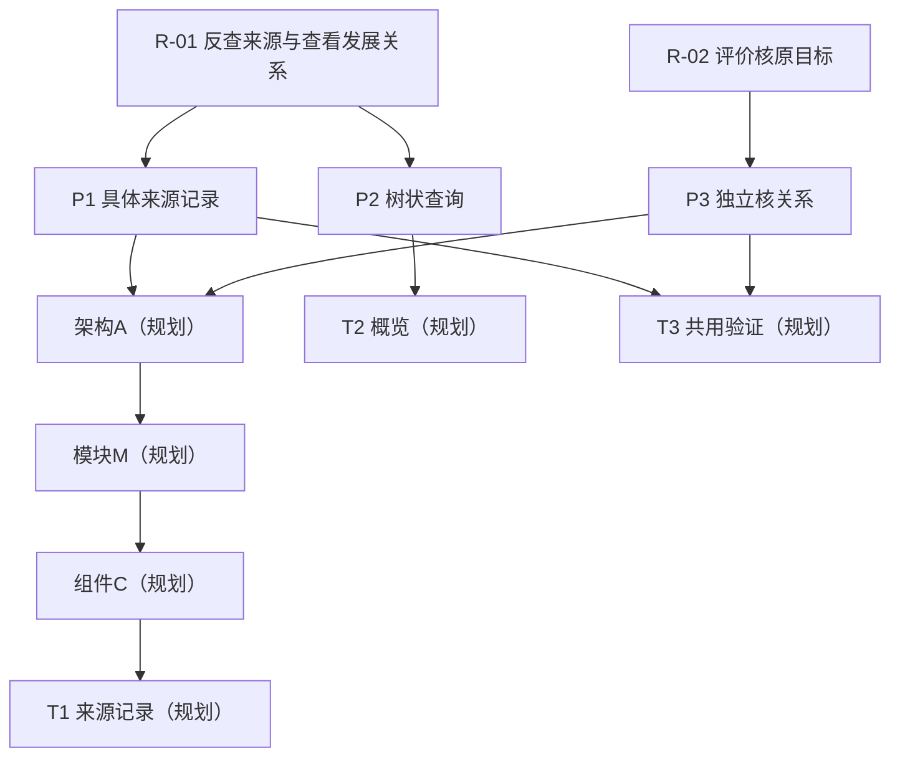

# 需求贯通示例

以下示例均为模拟关系，不是当前项目需求、确认或执行证据；正文规则仍以 [需求贯通](traceability.md)为准。

## 6. 示例：同一关系的拆分、共享和反查

以下是技能产品的**模拟关系**，不是当前项目的新需求、实际确认或执行证据。假定原始确认 R-01 要求“每个开发任务可反查具体原需求，并能查看需求的发展关系”，R-02 要求“独立评价核目标未偏移”；树状查询是此例已确认的呈现选择。示例身份均为 demo-r1 的规划内容，表中标识指向同一示例中的条目；用于真实项目时须换成实际正文位置与确认依据。

| 上游→下游 | 含义及承接落点 |
| --- | --- |
| R-01→PRD-P1、PRD-P2 | 分别细化为记录任务具体子集、展示正反查询；验收 A1／A2 各对应一个结果 |
| R-02→PRD-P3 | 评价方核固定原始依据及共享来源；验收 A3 不采用作者自定成功线 |
| PRD-P1／P3→架构-A；架构-A→模块-M；模块-M→组件-C | 同一关系读取契约支持任务定位和评价取证；各设计条目正文只维护一次，两来源各核用途，按此责任链承接 |
| PRD-P1、A1、组件-C→任务-T1 | 形成任务来源记录；只承接 P1，不能因为同包就声称也实现 P2 |
| PRD-P2、A2→任务-T2 | 形成树状查询视图，引用 T1 已定义关系，不复制模块映射 |
| PRD-P1／P3、A1／A3→任务-T3 | 共用验证任务，分别设计来源定位和独立核关系的用例；不是代替独立评价方执行 |
| T1→实现-I；A1→用例-V→证据-E | 均为待形成节点；E 只有对实际 I 执行 V 并取得结果后才登记实际证据，不预写通过 |

**图示范围：下图是 demo-r1 的主要节点概览。** 验收 A1／A2／A3、实现-I、用例-V、证据-E及未展开的直接边见上表；省略不表示没有这些关系。本图不能单独用于完整覆盖核对，反查任务时须回到同一关系表。

反查 T1 时，沿其具体子集 P1／A1 和 C 回到 R-01 的实际确认；T3 则须分别查 R-01、R-02，不能漏列共享来源。假如 P1 偷改为“仅包级可反查”，即使图上仍连到 R-01，也违反任务级目标，应在语义核对中报告。

回述、分别转写确认对象／范围／后续许可的示例见 [messages](messages.md) 与 [requirements §1](../rules/requirements.md#1-边沟通边保存)；示例图不授予许可，未回应的新增选择相关分支继续待决。
